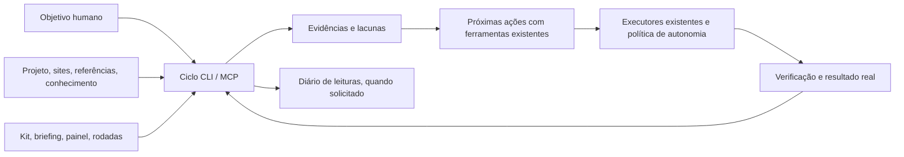

# Ciclo operacional por objetivo — CYC1.1

Direção autorizada em 11/10/2026: coordenar projetos usando conhecimento, referências, ativos e resultados; humanos definem objetivo/estratégia. Piloto: SlimSoda, sem misturar variantes.

## Decisão e preservação

1. **Coordenação por objetivo (escolhida):** reunir evidências e propor a próxima execução via CLI/MCP, reaproveitando mapas, kit, briefing, placares e fábrica.
2. Produção primeiro: gera mais peças, mas não resolve destino, mensuração e economia.
3. Tráfego primeiro: melhora cortes, mas depende de fontes confiáveis e limites já autorizados.

Validação arquitetural e PO: camada aditiva; não duplicar autopilot, fábrica, filas, mapas ou permissões. Nenhuma mudança de schema. O diário existente guarda objetivos e leituras explicitamente registradas, sem substituir project.data. Leituras simples não gravam.



## Contrato da primeira entrega

- `get_project_cycle(project_id, objective?)`: inventário, objetivo (informado, último registrado ou pendente), metas, fontes disponíveis/ausentes/antigas/com erro, diagnóstico econômico e próximas ações com ferramenta, dependências e verificação.
- `record_project_cycle(project_id, cycle_id, objective?)`: registra uma leitura no diário. `cycle_id` UUID é o identificador idempotente; a mesma tentativa não sobrescreve a primeira. Consulta prévia e chave primária do diário evitam duplicação concorrente.
- `scripts/project-cycle.mjs`: CLI via MCP autenticado; `--local` consulta o banco linkado com o mesmo motor. `--record --cycle-id UUID` registra explicitamente o diário, com ambos os transportes. Configuração de transporte via ambiente/CLI autenticada, sem credenciais em argumentos/arquivos.
- Fontes filtradas pelo ID exato do projeto. Sites via vínculo explícito, referências e outputs via project_id. Não importar automaticamente o acervo de outra variante.
- Metas mensais reutilizam `imphq_project_goals`; incompatibilidade de tipo ou erro aparece como fonte com erro, nunca como ausência de meta.
- Fontes com teto de leitura declaram limite; não são inventário ilimitado. Cadastros não comprovam publicação, vendas ou pesquisa validada.
- Clarity: ler métricas agregadas existentes, distinguindo cadastro/configuração de análise real de heatmap/replay.
- Rentabilidade: receita e gasto não comprovam lucro líquido. CPA alvo, moedas, checkout confirmado e sync atual são pré-condições; custos de produto, taxas, reembolsos e operação continuam necessários.
- Registro de ciclo é observação/proposta, não marca nenhuma ação como executada. Nenhuma alteração de anúncio, publicação, geração paga ou mensagem é disparada pelo planejador.

## Evolução da estrutura

1. Coordenador com evidência e diário (esta story).
2. Conectar ações internas a contratos de etapa existentes; execução durável, exclusão atômica, retomada e verificação por resultado antes de liberar autonomia adicional.
3. Incorporar custo completo/margem e atribuição por oferta; alimentar seleção de hipóteses com rodadas verificadas.
4. Ampliar fontes de comportamento (Clarity/Analytics) e testes de páginas; registrar fonte e hipótese, jamais inferir heatmap a partir de scroll médio.
5. Rodada proativa também para projetos em preparação, respeitando opt-in e limites por projeto; só depois expandir de um piloto para outros.

## Validação

Testes: erro versus ausência; data antiga; isolamento por projeto; fontes financeiras incompletas/moedas; prioridade de mensuração sobre volume; replay do diário; autenticação MCP. Rodar lint, typecheck, suíte e build. Validar SlimSoda real em leitura antes de qualquer registro ou lote. Produção exige publicação e chamada autenticada das ferramentas; testes locais não provam deploy.

## Operação

```powershell
# Diagnóstico real, sem UI e sem alterar campanhas
node scripts/project-cycle.mjs --local --project slimsoda

# Novo objetivo: registro explícito, append-only e idempotente
node scripts/project-cycle.mjs --local --project slimsoda --objective "Objetivo e estratégia" --record --cycle-id <UUID>

# Pela conexão MCP: configurar IMPERIO_MCP_URL e IMPERIO_MCP_KEY no ambiente
node scripts/project-cycle.mjs --project slimsoda
```

Antes de gerar peças, o agente consulta `get_project_cycle`, lê os contratos das etapas e recupera o conteúdo das skills e referências apontadas. O diagnóstico não substitui essa leitura nem aprova o próprio trabalho. `next_actions` prepara chamadas; dependências são bloqueios a resolver, não ações concluídas automaticamente.

O transporte local limita o snapshot a 100 cadastros por fonte e 5000 registros transacionais, usa o painel compartilhado e acessos declarados. O briefing completo exige a conexão MCP. O loader declara esse limite em vez de esconder a fonte indisponível.
